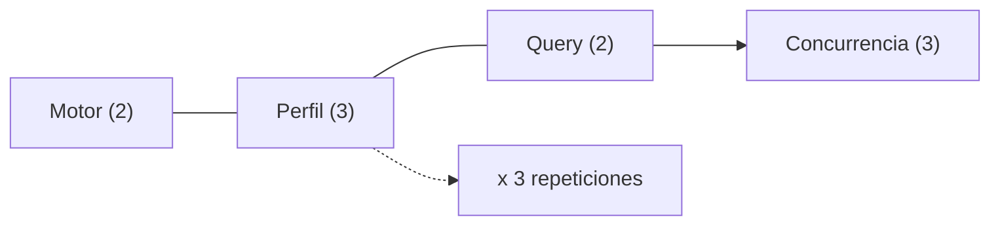

# Medición de métricas en bases documentales: MongoDB frente a PostgreSQL JSONB bajo contención

> **Rol del documento (`Puente`):** El archivo [[playbook_especificacion_tecnica]] (`playbook.pdf`) es la especificación técnica; estas diapositivas fijan el **contrato de entrega** y validación para revisión por pares.

---

## 1. Recorrido y Propósito (`Pregunta Guía`)

- **Pregunta guía:** ¿Qué hay que medir, cómo se ejecuta y qué evidencia entregar para que un estudio posterior (y un revisor) puedan reproducir y cuestionar el resultado?
- **Flujo de trabajo:** `Qué medimos` $\rightarrow$ `Cómo se corre` $\rightarrow$ `Ejemplo de celda` $\rightarrow$ `Qué entregar`.
- **Objetivo de salida (`Al salir`):** Entender la matriz $\text{Mongo/Postgres} \times \text{perfiles} \times \text{Q1/Q2} \times \text{concurrencia}$, y el CSV/reporte que alimenta un estudio.

---

## 2. Definición de la Actividad (En una frase)

Comparar **MongoDB** (documentos) y **PostgreSQL JSONB** al ejecutar agregaciones JSON anidadas, con límites estrictos de CPU y memoria (**Docker cgroups v2**).

### Parámetros de la Actividad
- **Dataset:** $500\,000$ órdenes con $\sim 3$ niveles de anidamiento.
- **Dos cargas:**
  - `Q1`: `unwind` + `group` (Saturación de CPU).
  - `Q2`: `sort` + `Top-K` (Estrés de buffer).
- **Tres perfiles:** `baseline` / `media` / `severa`.
- **Tres concurrencias:** `1`, `10`, `50`.
- **Rigor experimental ("No es probar si arranca"):** Cada corrida produce **métricas numeradas** (`latencia`, `QPS`, `throttling`, `RSS`, `spill`, `OOM`) en un **CSV homogéneo**.

---

## 3. Preguntas de Investigación que Responden las Métricas

| ID | Pregunta de Investigación | Uso para el Equipo | Uso para el Estudio / Revisor |
| :--- | :--- | :--- | :--- |
| **M1** | ¿Cómo cambian P95/P99 al limitar CPU y memoria? | Guían qué celdas priorizar y qué contraste reportar. | Son las mismas preguntas que un revisor pedirá justificar con datos. |
| **M2** | ¿Qué motor gestiona mejor buffers antes de spill o OOM? | Identificar degradación por memoria vs disco. | Evidenciar comportamiento bajo presión de memoria. |
| **M3** | ¿Cuál es la huella de CPU/memoria por cada $1\,000$ documentos? | Evaluar eficiencia de recursos por unidad de volumen. | Comparativa normalizada de huella operativa. |

---

## 4. Perfiles de Recursos y Regla de Registro Operativo (Diapositiva 5 reconstruida)

| ID de Perfil | Nombre Operativo | CPUs (`cpus`) | RAM (`mem_limit` = `memswap_limit`) | `shared_buffers` (Postgres) | `wiredTigerCacheSizeGB` (Mongo) |
| :--- | :--- | :--- | :--- | :--- | :--- |
| `PROFILE_A_BASELINE` | Sin contención (Baseline) | `4.0` | `4096m` (0 swap) | `1024MB` (25 %) | `1.5` GB |
| `PROFILE_B_MEDIUM` | Contención media | `2.0` | `2048m` (0 swap) | `512MB` (25 %) | `0.5` GB |
| `PROFILE_C_SEVERE` | Contención severa (throttling activo) | `1.0` | `1024m` (0 swap) | `256MB` (25 %) | `0.25` GB (mínimo) |

*Cachés con la regla por defecto de cada fabricante: PostgreSQL 25 % de la RAM; MongoDB $\max(0.25, 0.5 \times (\text{RAM} - 1\text{ GB}))$.*

- **Qué anotar siempre:** `profile`, límites Docker reales, versión/digest del motor, variante de memoria (`work_mem` / `allowDiskUse`), número de muestras $n$ y si hubo `spill/OOM` (persistido en `meta.json` por cada fila del CSV).
- **Invalidez de celda:** Sin esos datos registrados, **la celda no sirve para el estudio**.

---

## 5. Diseño de Cargas de Trabajo (Resumen Conceptual)

### 5.1 Ejemplo Q1: Saturación de CPU (y Spill de Agrupamiento en Postgres)
- **Operación:** Desanidar `items`, filtrar `price > 50`, agrupar por país (`country`) y categoría (`category`).
- **Equivalencia Conceptual:**
  - **MongoDB (idea):**
    ```text
    $unwind items
    $match price > 50
    $group by country, category
    ```
  - **PostgreSQL (idea):**
    ```sql
    jsonb_array_elements
    + WHERE price > 50
    + GROUP BY country, category
    ```
- **Métrica a mirar:** Throughput y P95/P99; en contención severa, tiempo **CFS throttled** y **spill/OOM** en PostgreSQL cuando el planificador estima $16.5\text{ M}$ de grupos y elige `Sort + GroupAggregate` con `work_mem = 4MB`.

### 5.2 Ejemplo Q2: Top-$K$ acotado (control negativo de memoria)
- **Operación:** Filtrar órdenes completadas (`completed`), ordenar por `final_total`, obtener `Top-1000`.
- **Variantes de configuración de memoria por motor (aplicadas en Q1 y Q2):**
  - **MongoDB:** `allowDiskUse: false` (`strict`) / `allowDiskUse: true` (`relaxed`).
  - **PostgreSQL:** `work_mem 4 MB` (`strict`) / `64 MB` (`relaxed`).
- **Nota técnica sobre el ejemplo de la diapositiva 7:**
  - En `Q2` con `LIMIT 1000`, ambos motores aplican *Top-N heapsort* acotado ($\sim 275\text{ KB}$ en Postgres, $\sim 1.35\text{ MB}$ en Mongo) y no desbordan memoria; además, en MongoDB `allowDiskUse: false` nunca hace spill sino que lanza excepción (código `292`) al superar 100 MB.
  - Por ello, el contraste empírico entre variantes `strict` (`4MB` / `allowDiskUse:false`) y `relaxed` (`64MB` / `allowDiskUse:true`) se evalúa tanto en `Q1` como en `Q2`, respondiendo **M2** con datos reales de spill/OOM.
- **Requisito para el revisor:** Hay que reportar **ambas variantes** (`strict` y `relaxed`). En `Q2` se espera `disk_spill = false` en las dos (control negativo); el contraste con spill/OOM lo aporta `Q1` bajo la **hipótesis dual**: en `PROFILE_C_SEVERE` (`1024 MB`), `relaxed` (`work_mem = 64MB`) alivia el spill de PostgreSQL en `c = 1`, pero en `c = 10` y `c = 50` puede adelantar el `OOMKill` porque `work_mem` es un tope por operador/proceso/worker paralelo y no un fondo compartido.

---

## 6. Anatomía de una Celda y Ejemplo de Fila CSV (Diapositivas 8 y 9 reconstruidas)



- **Dimensiones de la Matriz:**
  - **Matriz Principal (`mediciones.csv`):** $2\text{ motores} \times 3\text{ perfiles} \times 2\text{ queries} \times 3\text{ concurrencias} = 36\text{ celdas} \times 3\text{ repeticiones} = 108\text{ corridas}$ (variante `strict`: `work_mem=4MB`, `allowDiskUse=false`).
  - **Anexo de Variantes de Memoria (`anexo_variantes.csv`):** variante `relaxed` (`work_mem=64MB`, `allowDiskUse=true`) en `PROFILE_C_SEVERE` $\times$ `Q1`/`Q2` $\times$ $c = 1, 10, 50$ $= 12$ celdas $\times 3 = 36$ corridas, **más** `Q2_relaxed` en `PROFILE_A_BASELINE` y `PROFILE_B_MEDIUM` ($12$ celdas $\times 3 = 36$ corridas) para que `Q2` tenga ambas variantes en los 3 perfiles (lectura literal de la sección 5.2). Anexo total: $72$ corridas, con `query_id = Q1_relaxed` / `Q2_relaxed` para que la concatenación no duplique claves + `meta.json` individual por corrida.
  - **Duración estimada:** $108 + 72 = 180$ corridas $\times \sim 7$ min $\approx 21.5$ h.
- **Ciclo de ejecución por repetición (con recreación de contenedor para vaciar cachés internas):**
  $$\text{recrear contenedor} \rightarrow \text{flush caché OS} \rightarrow \text{warmup } 60\text{ s} \rightarrow \text{medición } 300\text{ s} \rightarrow \text{cooldown } 60\text{ s}$$
- **Producto mínimo por celda:** Una fila CSV por repetición + nota de estado (`ok` / `spill` / `oom` / `error`) + `meta.json` con $n$, `m3_memory_peak_mb`, `m3_memory_mb_s_per_1k_docs`, `cpu_usage_seconds` y versión.
- **Inmutabilidad del esquema CSV (Diapositiva 9):** *Sin columnas inventadas ni renombradas: el estudio posterior concatena todos los CSV.*

### Ejemplo de Filas CSV (Formato Esperado de 14 Columnas)
> Valores **ilustrativos** para mostrar el formato (no son resultados medidos). La tercera fila muestra cómo queda una celda con OOM (percentiles vacíos) y la cuarta una fila del anexo.

```csv
timestamp_epoch,engine,profile,query_id,concurrency,run_number,throughput_qps,latency_p50_ms,latency_p95_ms,latency_p99_ms,cpu_throttled_seconds,max_rss_mb,disk_spill,status
1793418513,mongodb,PROFILE_A_BASELINE,Q1,1,1,0.777,1286.462,1303.068,1342.679,0.000,727.547,false,ok
1793420216,postgresql,PROFILE_C_SEVERE,Q2,50,1,1.317,42147.279,58742.193,71264.783,364.498,577.812,false,ok
1793419361,postgresql,PROFILE_C_SEVERE,Q1,50,1,0.000,,,,997.241,952.828,true,oom
1793480102,postgresql,PROFILE_C_SEVERE,Q1_relaxed,10,2,0.212,44120.507,51877.310,55021.944,402.118,611.430,true,spill
```

---

## 7. Contrato de Entrega y Criterio de Utilidad

### Código / Scripts Requeridos
1. `docker-compose` parametrizado
2. Generador $500\text{k}$ (`synthetic_data_generator.py`)
3. Runner (`k6` o `Python`)
4. `queries/` (Mongo + SQL)
5. `run_benchmarks.sh`

### Evidencia Requerida
1. **CSV** con el esquema fijo (`mediciones.csv` + `anexo_variantes.csv`; las filas del anexo se distinguen por `query_id = Qn_relaxed`).
2. **Capturas o logs** de `spill/OOM` (`oom_evidence.log`, `spill_evidence.log`, `meta.json`).
3. **Reporte de métricas** (las 7 secciones del [[playbook_especificacion_tecnica]]).

> [!IMPORTANT]
> **Criterio de utilidad:** Si otro equipo no puede reejecutar o un revisor no puede cuestionar P99/throttling con sus datos, la entrega está incompleta.

---

## 8. Preguntas de Auditoría del Revisor y Checklist del Reporte (Diapositivas 11 y 12 reconstruidas)

### 8.1 Las 6 Preguntas del Revisor
El reporte debe contestar estas 6 preguntas **con tablas/figuras, filas del CSV y planes `explain` / `EXPLAIN ANALYZE`** (no con opiniones):

1. ¿El baseline es comparable (mismo dataset SHA-256, mismas queries)?
2. ¿Las latencias son P50/P95/P99 con tamaño de muestra $n$ explícito o solo promedios?
3. ¿Hubo throttling CFS? ¿Cuántos segundos (delta en la ventana de 300 s)?
4. ¿Spill a disco o OOM? ¿En qué perfil, query y concurrencia?
5. ¿Cuántas repeticiones (3) y cómo se resume (mediana y rango $[\min, \max]$)?
6. ¿El plan de ejecución respalda el cuello de botella (*Top-N heapsort* vs *GroupAggregate spill* / *IXSCAN* vs *Parallel Seq Scan*)?

### 8.2 Checklist de las 7 Secciones del Reporte (Diapositiva 12 reconstruida)

| # | Sección del Reporte | Evidencia Obligatoria que Debe Incluir |
| :--- | :--- | :--- |
| **1** | **Especificaciones del host y del entorno Docker** | CPU, RAM, kernel/WSL2 (Docker Engine dentro de la distribución, no Docker Desktop), versión de Docker, confirmación de `cgroups v2`, digests SHA-256 de imágenes y tabla de límites por perfil (`cpus`, `mem_limit`, `memswap_limit`, `shared_buffers`, `wiredTigerCacheSizeGB`). |
| **2** | **Método de medición y verificación del baseline** | Semilla (`42`), distribución del dataset ($500\text{k}$ docs), SHA-256 del flujo JSON, validación de sumas idénticas entre Mongo y Postgres, protocolo de recreación de contenedor + `drop_caches` y orden aleatorio de corridas. |
| **3** | **Resultados consolidados** | Tablas resumen (mediana y rango de las 3 repeticiones) para las 36 celdas base + anexo de variantes (`throughput_qps`, `P50`, `P95`, `P99` (no confiable si $n < 100$), $n$, `cpu_throttled_seconds`, `max_rss_mb`, `m3_memory_peak_mb` (nivel `anon + shmem` en MB), `m3_memory_mb_s_per_1k_docs` (integral $\text{MB}\cdot\text{s} / 10^3\text{ docs}$), `CPU_1k`, `disk_spill`, `status`). |
| **4** | **Análisis gráfico** | Curvas de `P99 vs concurrencia` por perfil (**M1**), `throttling CFS vs QPS` (**M1**), y `curva temporal de RSS / memory.peak` (**M2/M3**). |
| **5** | **Planes de ejecución** | Comparativa directa de `explain("executionStats")` (Mongo) frente a `EXPLAIN (ANALYZE, BUFFERS, VERBOSE)` (Postgres) para `Q1` y `Q2`, explicando el *Top-N heapsort* en `Q2` y la sobreestimación de $16.5\text{ M}$ de grupos en `Q1`. |
| **6** | **Interpretación: memoria, spill y throttling** | Respuestas formales a **M1**, **M2** y **M3**, impacto de `work_mem` (`4MB` vs `64MB`) y `allowDiskUse`, diferencia entre `anon` (WiredTiger) y `shmem` (`shared_buffers`), y efecto del paralelismo intra-consulta de Postgres bajo `1.0 CPU`. |
| **7** | **Recomendaciones técnicas para la nube** | Reglas prácticas de dimensionamiento de contenedores (cgroups v2), índices JSONB/estadísticas extendidas, tuning de `work_mem`/`max_parallel_workers_per_gather`, elección de motor según patrón de consulta, y la limitación del índice de `timestamp` (el `ALTER` sobre `pg_catalog` no es posible en PostgreSQL administrado: usar un wrapper `IMMUTABLE` propio). |

---

## 9. Siguiente Paso Recomendado en Laboratorio

1. Levantar perfiles `A/B/C`.
2. Correr una **celda piloto** ($1\text{ motor} \times 1\text{ query} \times 1\text{ concurrencia}$).
3. Validar el formato y valores del CSV y su `meta.json` antes de lanzar la matriz completa.

